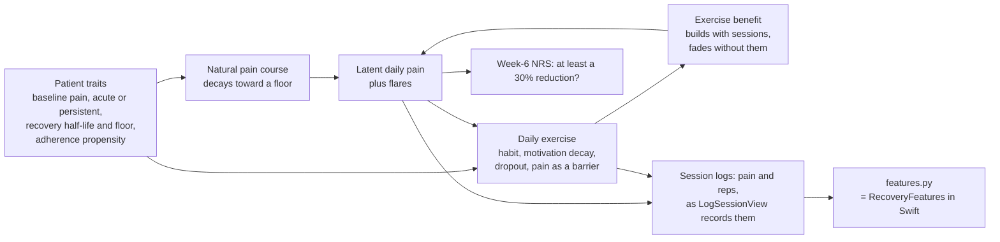
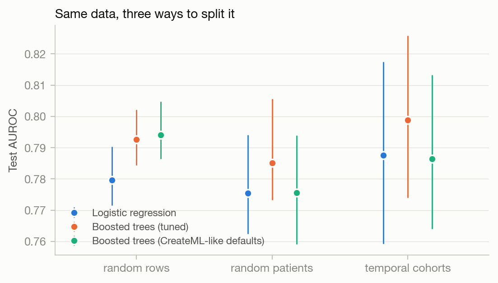
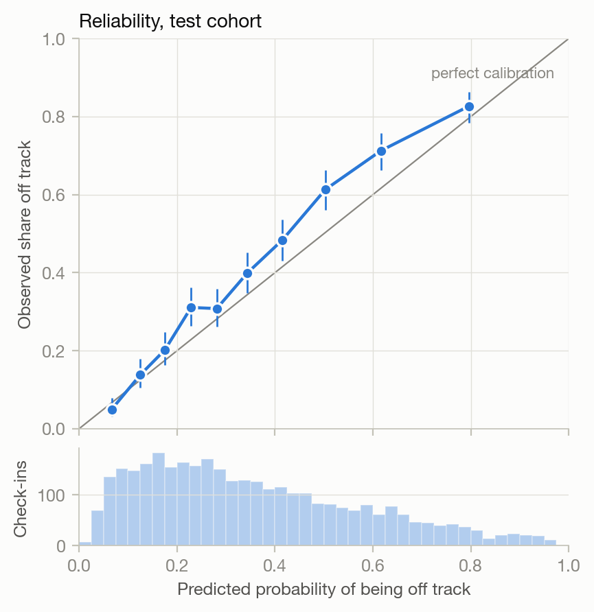
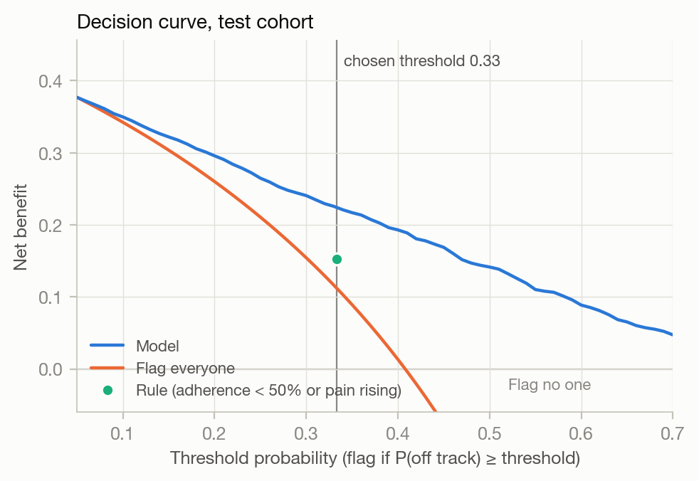
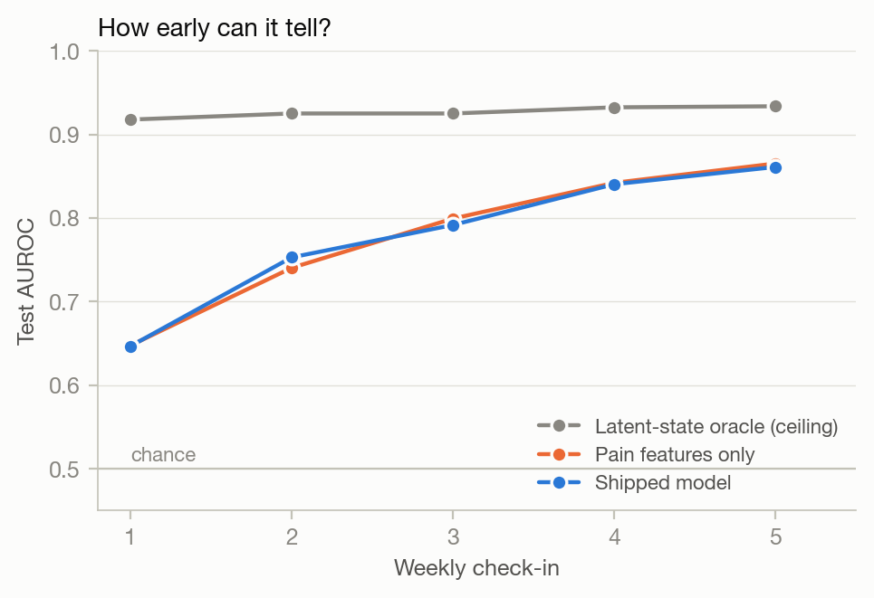
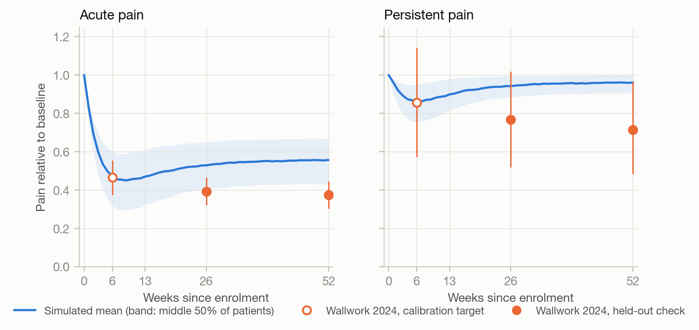

# Recovery estimate: a simulation study

The Home tab shows a card that says whether a patient is on track for their recovery goal. No public
dataset links physical-therapy exercise logs to recovery outcomes, so the model behind that card is
trained on simulated patients. This folder treats that honestly. It is a fully specified simulation
study:

- a documented generative process, with every parameter traced to a paper, a calibration target, or a
  stated assumption;
- evaluation split by patient and by time, never by row;
- results reported against a majority-class baseline and a hand-written rule, with calibration,
  a justified threshold, and an error analysis;
- one sub-component (the pain trajectory) checked against published data. It partly fails, and the
  failure is reported below.

**Every number here is a best case under the stated assumptions.** The model is tested on data from the
same process that trained it. Real patients would bring unmodelled causes, messier logging and noisier
outcomes, so expect real-world performance to be lower. The sensitivity analysis shows how far the
numbers move when the key assumptions change.

All results come from [`results/REPORT.md`](results/REPORT.md), which `run_study.py` generates.

## Headline

Test cohort: the 753 patients who enrolled after the training cutoff. Decision metrics cover the 2,784
weekly check-ins where the app shows a card; AUROC covers all 3,411 scored check-ins. 95% intervals
resample patients, not rows.

| | Shipped model | Comparison |
|---|---|---|
| AUROC | 0.788 (0.760-0.815) | 0.5 for any constant guess |
| Accuracy | 73.7% (71.2-76.1) | 59.2% for "always on track" (+14.5 points, 10.1-19.0) |
| Balanced accuracy | 73.9% (71.4-76.3) | 63.4% for the rule below (+10.4 points, 8.0-12.9) |
| Sensitivity (off track caught) | 74.8% (70.6-78.6) | 65.6% for the rule |
| Specificity | 72.9% (69.6-76.1) | 61.3% for the rule |
| Precision when flagged (PPV) | 65.6% (61.1-70.0) | 53.9% for the rule |
| Calibration | right on average during development, 5 points low on the later cohort | see below |

"The rule" is the logic the app's rationale text already implied: flag if 7-day adherence is below 50%
or pain is rising. The model beats it clearly, and beats always answering "on track", but the base
rate matters. 59% of check-ins are on track, so accuracy alone flatters any model.

### What changed from the original pipeline

The original `generate_synthetic_data.py` / `train_model.swift` reported "~77% held-out accuracy".

- **There was nothing to split by.** Each of the 4,000 rows was drawn independently: no patients, no
  time. A random row split could not leak, but it also could not test anything a deployed model faces.
- **77% was barely above the base rate.** 71.7% of rows were on track, so always answering "on track"
  scored 71.7%.
- **Most rows were impossible in the app.** Features were sampled directly rather than computed from
  logs. Only 6 of 4,000 rows had an adherence value the app can produce (a multiple of 1/7). 40% paired
  a 7+ day streak with less than 100% 7-day adherence, which the app's streak logic rules out.
- **The label was the author's formula.** "On track" was a noisy logistic function of the features, so
  the model was learning the generator's own equation back.

## Study design

Organized with the ADEMP structure for simulation studies (Morris, White & Crowther 2019).

| | |
|---|---|
| **Aim** | Estimate how well an on-device model using the app's six features predicts week-6 non-response, and choose a decision policy for the Home card. |
| **Data-generating mechanism** | 3,000 patients over two years of enrolment, simulated day by day (below). |
| **Estimand** | P(off track) at each weekly check-in. Off track = less than a 30% reduction in pain (0-10 NRS) from enrolment to week 6, the clinically important threshold from Farrar et al. 2001. |
| **Methods** | Always "on track"; the rule; logistic regression; gradient-boosted trees; plus an oracle that sees the latent state, as a ceiling. |
| **Performance measures** | AUROC, Brier skill, log loss, calibration intercept and slope, reliability curve; at the chosen policy: confusion matrix, per-class precision and recall, patient-level catch and false-alarm rates, net benefit. |

## The data-generating process



Every parameter is in `SimConfig` ([`simulate.py`](simulate.py)), tagged **[L]** from the literature,
**[C]** calibrated to a published number, or **[A]** assumed. The ones that matter most:

| Component | How it is simulated | Source |
|---|---|---|
| Plan and outcome | 6-week daily home programme; outcome is clinic NRS at week 6 vs enrolment; on track = at least a 30% reduction | [A], Farrar 2001 [L] |
| Case mix | Acute or persistent pain (12+ weeks). The persistent share rises from 25% to 45% across enrolment, a deliberate drift to give the temporal split something to find | [A] |
| Natural course | Exponential decay toward a patient-specific floor; half-lives of 14 days (acute) and 30 days (persistent); floors solved so mean pain at week 6 matches Wallwork 2024 (acute 46% of baseline, persistent 86%) | [A] half-lives, [C] floors |
| Exercise behaviour | Daily probability from a patient propensity, a habit term, motivation decay, permanent dropout, and pain as a barrier. Propensity solved so half of patients exercise on fewer than half of plan days | [C] Argent 2018, Essery 2017; direction [L] Jack 2010, Pisters 2010; sizes [A] |
| **Exercise effect** | Each session adds to a benefit that builds and fades with a 2-week half-life. Sized so 70% adherence lowers week-6 pain by 1.36 points, the pooled exercise-vs-control effect (12/100 in Fransen 2015, 15.2/100 in Hayden 2021) | [C], 70% trial adherence [A] |
| Flares | Transient spikes of 1-3 points, about one every 40 days, 3-day half-life | [A] |
| Logging | Every performed session is logged (headline). Each log's pain is latent pain plus noise; 15% of entries leave the slider at its default of 3; 30% leave reps at the target | [A] |

**Nothing the model sees is sampled directly.** The simulator emits `ExerciseLog`-shaped rows, and
[`features.py`](features.py) computes the six features from them with the same algorithm
`RecoveryFeatures` runs in the app. A shared fixture of 32 log histories
(`PTProgressTrackerTests/Fixtures/feature_parity_cases.json`) holds both implementations to 1e-9:
`tests/test_features.py` on the Python side, `FeatureParityTests.swift` on the Swift side.

## Splitting by patient and by time

Each patient contributes up to five weekly check-ins that share one outcome. The splits
([`splits.py`](splits.py)):

- **Temporal cohorts (headline).** Development: patients whose week-6 outcome was known before
  2025-07-01 (2,088 patients). Test: patients who enrolled on or after it (753). The 159 patients who
  were mid-plan at the cutoff are embargoed from both: their labels didn't exist yet at training time.
- **Patient-grouped folds.** Model selection and calibration use 5-fold cross-validation on the
  development cohort, grouped by patient and stratified by outcome. The code asserts that no patient
  appears on both sides of any fold, and the tests check it again.
- **Features never look ahead.** A check-in only sees logs up to that moment. `tests/test_simulate.py`
  checks that later logs don't change it.

### Why it matters: the leakage experiment

The same models, refit on 20 random 80/20 splits of all check-ins, once by row (what
`MLDataTable.randomSplit` did) and once by patient:



| Model | AUROC inflation from leaking patients (mean, SE) |
|---|---|
| Logistic regression | +0.004 (0.003), within noise |
| Boosted trees, tuned | +0.007 (0.003) |
| Boosted trees, CreateML-like defaults (depth 6, 1-sample leaves) | +0.018 (0.003) |

The leak is small here, probably because six coarse weekly features give a model little to memorise a
patient by. It still grows with model capacity, and it **changed which model looked best**. Under row
splits the CreateML-style trees come first; under patient splits they fall behind the tuned trees.
Leakage rewards memorisation, so it biases model choice toward models that overfit. The simulator
gives each patient only a few stable quirks and real patients have more, so don't expect the leak to
stay this small.

Discrimination did not suffer on the later cohort: AUROC was 0.788 on the temporal test set vs 0.775
out-of-fold. The later cohort has more persistent-pain patients, and a more mixed cohort is easier to
rank. **Calibration is what broke, and only the temporal split shows it.**

## Model selection

8 candidates, compared by cross-validated log loss (a proper scoring rule, which rewards calibrated
probabilities where accuracy does not). The rule was declared before seeing results: the simplest family
within one standard error of the best wins.

| Candidate | CV log loss (SE) |
|---|---|
| Best logistic regression (C = 0.1) | 0.5303 (0.0070) |
| Best boosted trees (100 trees, depth 3) | 0.5229 (0.0078) |

The logistic model came in within one SE of the boosted trees (0.5303 vs a cut-off of 0.5307), so it
shipped. On the test cohort the boosted trees did slightly better (AUROC 0.799 vs 0.788). That result
arrived after the decision, and switching models on the strength of it would have made the test set
part of training. The logistic model is also a handful of coefficients a clinician can read, and their
signs are sensible: current pain and rising pain push risk up, and adherence, completion and streak
push it down.

## Calibration over accuracy

For a nudge, what matters is whether "70% likely off track" is right 70% of the time. Platt
recalibration was fitted on out-of-fold predictions. It came out near a no-op (a = 0.997, b = -0.002)
because logistic regression is already calibrated on the data it was fitted to.



| Check-ins | Predicted | Observed | Calibration intercept | Slope |
|---|---|---|---|---|
| Development, out-of-fold, all | 34.0% | 34.0% | 0.00 | 1.00 |
| Development, acute pain | 28.6% | 14.8% | -1.00 | 0.75 |
| Development, persistent pain | 46.0% | 76.9% | +1.65 | 0.98 |
| **Test, all** | **35.5%** | **40.4%** | **+0.27** | 1.09 |
| Test, with pain duration as a feature (hypothetical) | 40.3% | 40.4% | +0.01 | 1.02 |

The probabilities are only right on average. The app's features can't tell acute from persistent pain
well, so the model says 29% for acute patients whose true rate is 15%, and 46% for persistent patients
whose true rate is 77%. During development those errors cancel. After the case mix shifts toward
persistent pain they don't, and the test cohort's risk is underestimated by about 5 points (more in
the middle of the range; see the diagram).

Two consequences:

1. **Monitor calibration-in-the-large after deployment and refit the intercept when it drifts.** Accuracy
   and AUROC would not have caught this.
2. **Ask one intake question: "has this pain lasted more than 3 months?"** With pain duration as a
   feature, AUROC rises from 0.788 to 0.891 and calibration recovers (intercept +0.01). In the
   simulation chronicity is a dominant cause by construction, so treat the size of that gain as
   optimistic. The direction is well supported: Wallwork 2024's acute and persistent cohorts follow very
   different courses. The unused `RecoveryPlan` entity is the natural place to store the answer.

## Choosing the threshold

With calibrated probabilities, flagging when P(off track) >= 1 / (1 + k) minimises expected cost when
a miss costs k times a false alarm.

- **A false alarm** tells a patient who is recovering that their pace "needs attention". It is mildly
  discouraging, and repeated false alarms teach patients to ignore the card, which costs the true
  alarms their value.
- **A miss** means a patient heading for a poor result gets no prompt that week. They are re-scored the
  following week and still see their therapist, so one miss is recoverable. A patient who is *never*
  flagged is the costly case.

So a miss is worse than a false alarm, but not overwhelmingly: **k = 2, threshold 1/3.** Because
the card repeats weekly, the decision was checked at the patient level on the development cohort (never
the test cohort):

| Threshold | Warm-up | Off-track patients ever flagged | Dangerous misses* | On-track patients with at least 1 false alarm |
|---|---|---|---|---|
| 0.50 | none | 65.2% | 9.6% | 27.3% |
| 0.33 | none | 80.9% | 4.0% | 55.3% |
| **0.33** | **7 days** | **79.8%** | **4.1%** | **43.5%** |
| 0.25 | 7 days | 86.6% | 2.0% | 61.1% |

\* Off-track patients who were scored but never flagged and improved less than 10%, as a share of all
off-track patients.

Raising the threshold to 0.5 more than doubles dangerous misses; lowering it to 0.25 puts a false alarm
in front of 6 in 10 recovering patients. Separately, week-1 predictions are weak (AUROC 0.65
out-of-fold), so **the card waits for 7 days of logging history.** That cuts false-alarm exposure from 55%
to 44% of on-track patients, and dangerous misses stay at 4%. (Disclosure: I considered the warm-up after a
debugging run had printed the test cohort's by-week table. The decision rests on the development numbers
above, which show the same pattern.)

On the test cohort the model's net benefit is above "flag everyone" at every threshold, and above the
rule at the chosen one:



Both constants ship in the generated `PTProgressTracker/ML/RecoveryModelPolicy.swift`.

## Error analysis

Test cohort, check-ins where a card is shown, threshold 1/3. The simulation knows each patient's true
state, so errors can be explained, not just counted.

|  | Flagged | Not flagged |
|---|---|---|
| **Actually off track** | 850 | 286 |
| **Actually on track** | 446 | 1,202 |

| Class | Precision | Recall | Support |
|---|---|---|---|
| Off track (flagged) | 65.6% | 74.8% | 1,136 |
| On track (not flagged) | 80.8% | 72.9% | 1,648 |

**Who it misses (286 check-ins).** Mostly patients doing everything right whose pain is easing too
slowly. 73% have persistent pain. They had exercised on 67% of days, against 42% for the off-track
patients it caught, and their logged pain was falling (trend -0.95). 46% ended with a 20-29% reduction,
just short of the bar. 19% were still exercising at the check-in and quit before week 6, which no model
could have seen coming. **Clinically these are the risky misses.** An adherent slow responder needs
their plan reviewed, and nothing in the app's data separates them from someone on track. The app's
rationale text now says this when it does flag such a patient ("worth reviewing your plan with your
therapist") instead of the old "aim for full sets and reps".

**Who it false-alarms (446 check-ins).** Mostly acute-pain patients (71%) with patchier exercise (46% of
days) who recovered anyway (46% average reduction), plus flares: 12% had a pain spike at the check-in,
against 7.5% of correct all-clears. **These are annoying rather than dangerous, but they are common.**
Over five check-ins, 45% of on-track patients see at least one false alarm and 29% see two or more. So
the card has to read as a nudge, not a warning. It is also why the threshold is not lower.

**Per patient**, over the five check-ins:

| Off-track patients (323) | Share |
|---|---|
| Flagged by week 3 | 70.0% |
| First flagged at week 4-5 | 11.8% |
| Shown a card, never flagged, improved less than 10% (dangerous miss) | 5.0% |
| Shown a card, never flagged, improved 10-29% | 4.3% |
| **Never scored: fewer than 3 logs at every check-in** | **9.0%** |

**The biggest blind spot is not a model error.** Check-ins with fewer than 3 logs get no card, and
66.7% of them belong to off-track patients, the highest-risk group in the data. 29 off-track patients
(9%) never logged enough to be scored, more than the 16 dangerous misses the model made. A rule-based
prompt for sparse logging would reach them. It needs the plan's start date, which the app doesn't
record yet (another use for `RecoveryPlan`).

## What the model actually uses, and how early



| Test AUROC | All check-ins | Week 1 | Week 5 |
|---|---|---|---|
| Shipped model (6 features) | 0.788 | 0.647 | 0.861 |
| Pain features only | 0.787 | 0.647 | 0.865 |
| Adherence features only | 0.678 | 0.570 | 0.723 |
| Oracle that sees the latent state | 0.927 | 0.918 | 0.934 |

- **It is a pain-trend model.** Adherence features predict on their own (0.678), but add nothing once
  pain is known. In this simulation adherence affects the outcome *through* pain, which the app observes
  directly.
- **Predictive is not causal.** With the exercise effect set to zero (next section), adherence features
  still reach AUROC 0.61, because pain suppresses adherence (Jack 2010). A model that uses adherence
  does not show that adherence helps.
- **The gap to the ceiling is missing information, not a missing model.** The oracle's 0.93 is roughly
  the limit: what remains is randomness that hasn't happened yet (dropout, flares). Most of the gap from
  0.79 is chronicity (0.891 with pain duration added).

## Sensitivity analysis

The two assumptions that most shape the result, varied across 5 replicate cohorts each. Each scenario is
recalibrated so the average week-6 course still matches the literature, and the same model spec and
policy are used throughout ([full table](results/REPORT.md#sensitivity-analysis)).

| Exercise effect | Sessions logged | AUROC (SD) | Adherence-only AUROC | Sensitivity | Specificity | Calibration intercept |
|---|---|---|---|---|---|---|
| none | 100% | 0.754 (0.013) | 0.610 | 72.6% | 71.9% | +0.27 |
| half | 100% | 0.763 (0.010) | 0.639 | 73.0% | 70.6% | +0.25 |
| **literature (headline)** | **100%** | **0.785 (0.009)** | **0.702** | **74.7%** | **72.8%** | **+0.24** |
| double | 100% | 0.835 (0.008) | 0.801 | 76.8% | 78.4% | +0.19 |
| literature | 70% | 0.773 (0.017) | 0.686 | 72.0% | 72.6% | +0.23 |

Discrimination runs from 0.75 to 0.84 depending on an effect size the real world has not measured for
this population. Losing 30% of logs costs about 0.01. The drift miscalibration appears in every
scenario.

## Validating one sub-component against published data

The pain trajectory is the one part of the simulator with real outcome data to check against. The same
simulated patients were run out to 52 weeks. After week 6 they follow the same process: motivation keeps
decaying, dropouts stay out, and the exercise benefit fades without sessions. The results were then
compared with Wallwork et al. 2024's pooled back-pain cohorts and Artus et al. 2010's pooled trial arms.
**Week 6 was a calibration target. Weeks 26 and 52 and the Artus shape were not used to set anything.**



| Target (pain relative to baseline) | Published (95% CI) | Simulated | Verdict |
|---|---|---|---|
| Acute, week 6 | 0.46 (0.38-0.55) | 0.47 | calibration target |
| Acute, week 26 | 0.39 (0.32-0.46) | 0.53 | **fails** |
| Acute, week 52 | 0.38 (0.30-0.45) | 0.56 | **fails** |
| Persistent, week 6 | 0.86 (0.57-1.14) | 0.87 | calibration target |
| Persistent, week 26 | 0.77 (0.52-1.02) | 0.94 | inside a very wide CI, moving the wrong way |
| Persistent, week 52 | 0.71 (0.48-0.96) | 0.96 | inside a very wide CI, moving the wrong way |
| Improvement at week 6 / week 13 (Artus) | 0.80 (0.51-1.23, crude) | 1.02 | inside, but pain rebounds where trials keep improving |

**The long-term course fails.** Published patients keep improving slowly after week 6. Simulated patients
rebound. The cause is structural: the natural floor was solved to leave room for the exercise benefit at
week 6, and that benefit fades once patients stop exercising after the plan.

Rerunning the held-out checks under each exercise-effect scenario narrows it down. Nothing was tuned to
this; it is a post hoc look at the key assumption:

| Exercise effect | Acute wk 26 | Acute wk 52 | Persistent wk 26 | Persistent wk 52 | Artus ratio |
|---|---|---|---|---|---|
| **Published** | **0.39** | **0.38** | **0.77** | **0.71** | **0.80** |
| none | 0.38 | 0.38 | 0.75 | 0.75 | 0.84 |
| half | 0.45 | 0.47 | 0.85 | 0.85 | 0.92 |
| literature (headline) | 0.53 | 0.56 | 0.94 | 0.96 | 1.02 |
| double | 0.68 | 0.73 | 0.98 | 1.02 | 1.23 |

The published long-term course matches the no-exercise-effect scenario almost exactly. The data can't
say whether that means exercise contributes less than the trials suggest, or that its benefit lasts
longer than the 2-week half-life assumed. Either way, the headline scenario gets the post-plan course
wrong.

What that means for the classifier:

- **The week-6 numbers barely move with this assumption** (AUROC 0.754 to 0.785), because the model
  mostly reads the pain trend.
- **What does move is the case for adherence.** Adherence features' predictive value, and the premise that
  nudging adherence changes outcomes, rest on an assumption this check does not support.
- **Don't use this simulator for anything after week 6.**

## Limitations

- **It is synthetic.** Every number depends on the generative process, and the one real-data check
  partly fails.
- **Logging equals exercising** in the headline. People forget to log. The 70%-logged scenario costs
  about 0.01 AUROC, but real logging gaps are unlikely to be random.
- **One fixed plan.** Real plans vary in length and frequency. The app doesn't know a patient's plan
  start or length, so `daysSinceStart` counts from the first log.
- **Pain is the only outcome.** Function and disability aren't modelled, and per-session pain in the app
  isn't the clinic NRS the label uses.
- **The drift is invented.** Its size is an assumption; its lesson (monitor calibration) is general.
- **The trajectory evidence is from back pain,** applied to a mixed musculoskeletal population.
- **Check-ins happen at fixed weekly moments.** The app scores whenever the Home tab renders.

## Reproducing

```bash
cd MLTraining
python3 -m pip install -r requirements.txt   # numpy, pandas, scikit-learn, statsmodels, matplotlib, pytest
python3 run_study.py                         # about a minute: results/REPORT.md, metrics.json, figures/
python3 -m pytest                            # 25 tests: feature contract, splits, simulator invariants
```

Everything is seeded, so reruns reproduce the committed results exactly. `--quick` cuts the bootstrap and
replicate counts for iteration.

To ship a retrained model to the app (needs `coremltools`, kept in a local virtualenv):

```bash
python3 -m venv --system-site-packages .venv
.venv/bin/pip install coremltools==9.0
.venv/bin/python export_coreml.py            # writes the .mlmodel and RecoveryModelPolicy.swift
```

The export reloads the `.mlmodel` through CoreML and checks it against scikit-learn on every test check-in
(largest difference: 2.2e-16), so the results here describe the file that ships. After changing
`features.py`, run `python3 make_parity_fixture.py` and make the same change in `RecoveryFeatures`.

| File | Role |
|---|---|
| `simulate.py` | Generative process, calibration, weekly check-ins |
| `features.py` | Python port of the app's feature contract |
| `literature.py` | Every published number used, with citations |
| `splits.py` | Temporal and patient-grouped splits |
| `models.py` | Candidates, baselines, selection, Platt calibration |
| `evaluation.py` | Metrics, reliability, decision curves, patient bootstrap |
| `run_study.py` | Runs everything; writes `results/` |
| `export_coreml.py` | Ships the model to the app and verifies the export |
| `make_parity_fixture.py` | Writes the Python/Swift feature-parity fixture |
| `tests/` | pytest suite |

## References

- Argent R, Daly A, Caulfield B. Patient involvement with home-based exercise programs: can connected health interventions influence adherence? *JMIR Mhealth Uhealth*. 2018;6(3):e47. doi:10.2196/mhealth.8518
- Artus M, van der Windt DA, Jordan KP, Hay EM. Low back pain symptoms show a similar pattern of improvement following a wide range of primary care treatments: a systematic review of randomized clinical trials. *Rheumatology*. 2010;49(12):2346-2356. doi:10.1093/rheumatology/keq245
- Essery R, Geraghty AW, Kirby S, Yardley L. Predictors of adherence to home-based physical therapies: a systematic review. *Disabil Rehabil*. 2017;39(6):519-534. doi:10.3109/09638288.2016.1153160
- Farrar JT, Young JP Jr, LaMoreaux L, Werth JL, Poole RM. Clinical importance of changes in chronic pain intensity measured on an 11-point numerical pain rating scale. *Pain*. 2001;94(2):149-158. doi:10.1016/S0304-3959(01)00349-9
- Fransen M, McConnell S, Harmer AR, et al. Exercise for osteoarthritis of the knee. *Cochrane Database Syst Rev*. 2015;1:CD004376. doi:10.1002/14651858.CD004376.pub3
- Hayden JA, Ellis J, Ogilvie R, Malmivaara A, van Tulder MW. Exercise therapy for chronic low back pain. *Cochrane Database Syst Rev*. 2021;9:CD009790. doi:10.1002/14651858.CD009790.pub2
- Jack K, McLean SM, Moffett JK, Gardiner E. Barriers to treatment adherence in physiotherapy outpatient clinics: a systematic review. *Man Ther*. 2010;15(3):220-228. doi:10.1016/j.math.2009.12.004
- Morris TP, White IR, Crowther MJ. Using simulation studies to evaluate statistical methods. *Stat Med*. 2019;38(11):2074-2102. doi:10.1002/sim.8086
- Pisters MF, Veenhof C, Schellevis FG, et al. Exercise adherence improving long-term patient outcome in patients with osteoarthritis of the hip and/or knee. *Arthritis Care Res*. 2010;62(8):1087-1094. doi:10.1002/acr.20182
- Van Calster B, McLernon DJ, van Smeden M, Wynants L, Steyerberg EW. Calibration: the Achilles heel of predictive analytics. *BMC Med*. 2019;17:230. doi:10.1186/s12916-019-1466-7
- Vickers AJ, Elkin EB. Decision curve analysis: a novel method for evaluating prediction models. *Med Decis Making*. 2006;26(6):565-574. doi:10.1177/0272989X06295361
- Wallwork SB, Braithwaite FA, O'Keeffe M, et al. The clinical course of acute, subacute and persistent low back pain: a systematic review and meta-analysis. *CMAJ*. 2024;196(2):E29-E46. doi:10.1503/cmaj.230542
